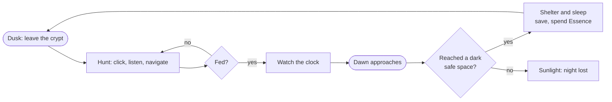
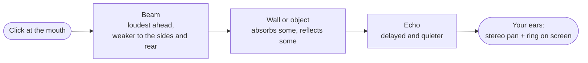

# Vampires Can't See

*A first-person night walk through a small town, played by sound alone: click, listen, and watch the echoes draw the world.*

`v0.10.3` · `plain JavaScript` · `no build step` · `504 unit tests` · `Playwright smoke test`

---

## What it is

You are a blind vampire. The screen is dark. A click sends out sonar, like a bat's, and the rings wrap around walls, doors, props and people in a minimal outline. You use that outline to move through a small town and into its interiors, find people to feed on, and reach your crypt or another dark, safe space before dawn.

It is plain JavaScript in the browser: no framework, no bundler, no install.



A night lasts 6 minutes. Hunger, fear and the powers (shriek, mist, still) shape the hunt. Essence buys permanent upgrades between nights.

## How sonar works

A click (left mouse button or Space) leaves the mouth, spreads as a beam that is loudest straight ahead, and travels outward. Where it meets a wall or object, the surface sends part of it back. The echo reaches your ears later and quieter, and the screen draws it as an expanding ring that brightens where the reflection is strong.



What you can read from an echo today: direction (stereo pan and where the ring lands), distance (delay and ring timing), and whether you are indoors or outdoors (room tone).

## The maths (planned v0.11)

> Status: designed from cited sources; not validated against measurements. None of this is in the game yet. It is specified in `docs/SPEC-echoes.md` (to be pushed) and will ship in stages behind flags that default to off.

**Tags used on every value**

| Tag | Meaning |
|---|---|
| **[source]** | Equation or value from a cited paper or reference; the form and arithmetic were checked against the standard textbook form |
| **[computed]** | Derived by the stated formula |
| **[estimate]** | Engineering judgement, no measurement behind it |
| **[tuning]** | Gameplay knob, no physical claim |

**Conventions.** Levels are in dB of intensity, relative to the direct click at 1 m on the beam axis. Distances are in metres: $r = d \cdot cellM$, with $d$ in cells and $cellM = 1.0$ m per cell. $c = 343$ m/s (standard value for air at 20 °C) [estimate].

### The mouth beam

The beam shape follows a fit to measured mouth clicks of blind expert echolocators [1][2], read as relative intensity. A head is modelled as a rigid sphere in [3][4][5][29]; its rear "bright spot" is left out because a real head and torso break it. The sphere gives about +6 dB high-frequency gain on the near side (pressure doubling, [4]); no frontal gain figure is taken from [3]-[5] or [29], and the beam's own shape comes from [1][2] only. The beam is applied once, on the outgoing click.

| Angle from facing | 0° | 30° | 60° | 90° | 120° | 150° | 180° |
|---|---|---|---|---|---|---|---|
| $B_{tx}$ (dB) | 0 | -1 | -3 | -5 | -8 | -13 | -18 |
| Tag | [computed] | [computed] | [computed] | [computed] | [computed] | [computed] | [tuning] |

Values from 0° to 150° are the fit mean rounded to 1 dB. The 180° value is a floor. Between nodes the beam is linear in dB and symmetric left to right. The receive side is 0 dB by default [tuning]; left and right come from stereo pan only.

### Echo level

A flat wall acts as a mirror: the echo behaves like a source at twice the distance, so it loses 6 dB per doubling [6]. A compact object or person re-radiates, so it loses 12 dB per doubling, and its strength is its target strength $TS$ [6].

Wall (specular, at the point where the ray meets the wall at 90°):

$$L_{wall}=B_{tx}(\theta)-20\log_{10}\!\frac{2\max(r,r_{min})}{1\,\mathrm{m}}+10\log_{10}(1-\alpha)+10\log_{10}(1-s)-2r\,a(f)$$

Object or person (sonar equation, $TS$ in dB re 1 m):

$$L_{obj}=B_{tx}(\theta)-40\log_{10}\!\frac{\max(r,r_{min})}{1\,\mathrm{m}}+TS-2r\,a(f)$$

| Value | Number | Tag |
|---|---|---|
| $r_{min}$ (near-field clamp) | 0.5 m | [tuning] |
| $TS$, prop of radius 0.3 m: $10\log_{10}(a^2/4)$ | -16.5 dB | [computed] [6] |
| $TS$, person | -15 dB (plausible range -20 to -5) | [estimate] |
| Absorption $\alpha$ of stone, brick, glass, wood | within about 0.5 dB of each other in the level term | [source] [19][23] |
| Grass, $10\log_{10}(1-\alpha)$ at $\alpha=0.6$ | -4.0 dB | [computed] [26] |

People absorb sound [21], but per-person figures are absorption areas, not a coefficient, so people use $TS$ instead of $\alpha$.

The energy that hits a surface is split three ways, each from the incident energy: absorbed $\alpha$, specular $(1-\alpha)(1-s)$, diffuse $(1-\alpha)s$. Rough surfaces such as cobbles scatter more [22][23]. A surface counts as rough when its bumps exceed the Rayleigh limit [24][25]; the smooth/rough label for visuals uses $\sigma_h<\lambda/(32\cos\theta_i)$, 0.315 cm at 3.4 kHz and normal incidence [computed]. The Rayleigh form $\lambda/(8\cos\theta_i)$ is from [25]; [24] gives only the normal-incidence form $\lambda/8$. Cobble size (200 × 100 × 100 mm setts, 10 mm joints) is from one Camden drawing [27] [estimate]; any 100-200 mm range is a design choice [tuning].

Game calibration, which is not physics, is applied afterwards: $L_{game}=G_{class}+\kappa L_{phys}$ with $\kappa\in[0,1]$ [tuning].

### Air absorption

Over the round trip the loss is $2r\,a(f)$, with $a(f)$ computed from the ISO 9613-1 equations (method only; [15] gives no tabulated values) at 10 °C and 70 % relative humidity [computed].

| f (Hz) | 500 | 1k | 2k | 3.4k | 4k | 8k |
|---|---|---|---|---|---|---|
| $a$ (dB/m) | 0.0019 | 0.0037 | 0.0097 | 0.0245 | 0.0331 | 0.1184 |

Over a 20 m path that is 0.49 dB at 3.4 kHz and 2.37 dB at 8 kHz: small, so it only matters for a high-pitched ping.

### Sound through walls (mass law)

$$TL(f)\approx 20\log_{10}(m f)-47$$

$m$ is surface mass in kg/m² and $f$ in Hz. The constant is -48 dB for random incidence [source] [7] and -47 dB for field incidence [source] [8]; the game uses -47. The normal-incidence constant (about -42.4, from $20\log_{10}(\pi/\rho c)$ with $\rho c=413$) is derived here, not in a cited source [computed]. Mixed walls (a door with a gap) combine by transmitted power: $\bar\tau=\sum S_i10^{-TL_i/10}/\sum S_i$, $TL=-10\log_{10}\bar\tau$ [computed]. A door with a 1 % open gap is limited to about 20 dB [computed].

Glass has a weak spot at its critical frequency, $f_c=c^2/(1.814\,c_L\,t)$ [computed]. For 4 mm glass that is 2989 Hz and for 6 mm glass 1993 Hz [computed]; the 3000 Hz for 4 mm glass comes from a trade source [9] and our 2989 Hz agrees. [10] is qualitative only and gives no 4 mm value. Brick and stone are capped at 55 and 65 dB [tuning] and are effectively silent; sound reaches you only by going around them.

### Around corners (Maekawa)

With $N=2\delta/\lambda$ and $\delta$ the extra path over the edge [source] [11]:

$$\Delta L=\begin{cases}0 & \text{line of sight clear}\\[2pt] \min\!\big(C_{cap},\,10\log_{10}(3+20N)\big) & \text{line of sight blocked, edge path exists}\\[2pt] \text{no path} & \text{fully occluded}\end{cases}$$

Grazing incidence ($N=0$) gives 4.77 dB [computed]. $C_{cap}=24$ dB [tuning]. A clear line of sight is exactly 0 dB, so the formula never adds loss to an open view.

### Rooms

Reverberation time from room volume $V$ and absorption $A=S\bar\alpha+4mV$, where $m=a/4.343$ is the air term [source] [12][13]:

$$T_{60}=\frac{0.161\,V}{A}$$

Each reverb comb filter gets its own feedback gain from its delay $\tau$ [computed]:

$$g=10^{-3\tau/T_{60}}$$

| Room (from `js/data/maps.js`) | Cells | Height [estimate] | $T_{60}$ at 1.0 m/cell, Sabine [computed] |
|---|---|---|---|
| Crypt | 12 × 7 | 3.0 m | 3.60 s |
| Tavern | 18 × 12 | 3.5 m | 1.26 s |
| Church | 16 × 14 | 8.0 m | 5.18 s |
| House (house1) | 10 × 8 | 2.7 m | 1.13 s |

Mean absorption $\bar\alpha$ per room is an [estimate] informed by [14][19][23]. The game clamps $T_{60}$ to 0.4 to 2.5 s [tuning] so clicks stay readable.

### Very close walls hum (repetition pitch)

When an echo returns within a few milliseconds of the click, the ear hears a pitch rather than a separate echo; the 30 ms limit is from [17], and [16] covers repetition pitch only:

$$f = \frac{c}{2d}$$

It is applied only for $d \le 2$ m [tuning], as a feed-forward comb $y(t)=x(t)+g\,x(t-\tau)$ with $\tau=2d/c$, because a feedback comb under about 2.7 ms is not possible in WebAudio.

### Timing

Physical echo delay is too fast to read as a ring, so the game keeps its own speeds [tuning]: the visual ring travels at 12 cells/s and the echo sound at 34 cells/s. The planned single arrival law (flag `echoTiming`) is

$$t_{echo}=\frac{d_{out}}{v_{vis}}+\frac{d_{back}}{v_{aud}}$$

giving 0.113, 0.564 and 1.127 s at 1, 5 and 10 cells [computed]. Physical time is used only for sub-30 ms structure such as the comb delay [17].

## Status

| Area | State | Version |
|---|---|---|
| Menus, pause, settings | Shipped | 0.10.3 |
| Save and load, with backup copy | Shipped | 0.10.3 |
| Night loop (6 min), dawn and shelter | Shipped | 0.10.3 |
| Hunger, feeding, fear | Shipped | 0.10.3 |
| Powers: shriek (Q), mist (Shift/C), still (F) | Shipped | 0.10.3 |
| Meta upgrades (Essence) | Shipped | 0.10.3 |
| Logging and error checks | Shipped | 0.10.3 |
| Tests: 504 unit (`node:test`), Playwright smoke test | Shipped | 0.10.3 |
| Balance simulator | Shipped | tools |
| Acoustics S1: pure maths module and data | Planned, flag off | 0.11 |
| S2: echo level (walls, objects, people) | Planned, flag `echoLevel` | 0.11 |
| S3: mouth beam | Planned, flag `beam` | 0.11 |
| S4: per-material occlusion and Maekawa | Planned, flag `occlusion` | 0.11 |
| S5: reverb per zone | Planned, flag `reverbZones` | 0.11 |
| S6: air absorption per band | Planned, flag `airBands` | 0.11 |
| S7: roughness and diffuse tails | Planned, flag `rough` | 0.11 |
| S8: repetition pitch | Planned, flag `repPitch` | 0.11 |
| S9: click ping option | Planned, flag `clickPing` | 0.11 |
| S10: visuals from echo level | Planned, flag `visuals` | 0.11 |
| S11: echo timing | Planned, flag `echoTiming`; needs a decision, since wall echoes get later | 0.11 |

All v0.11 flags default to off, which reproduces current behaviour exactly.

## Run it

Open `index.html` in a modern browser. Or serve the folder with any static server, for example:

```sh
python3 -m http.server 8000
# then open http://localhost:8000
```

There is no build and no install. Audio starts on your first click, as browsers require.

```sh
node --test tests/*.test.js     # unit tests
node tests/smoke.mjs            # browser smoke test (needs Playwright and Chromium)
node tools/check-secrets.mjs    # run before every commit
node tools/sim.mjs              # balance simulation
```

## Controls

| Input | Action |
|---|---|
| WASD or arrow keys | Move |
| Mouse | Look |
| Left click or Space | Sonar pulse |
| Right click or R | Drink |
| E | Open doors, sleep |
| Q | Shriek |
| Shift or C | Mist |
| F | Still |
| Esc | Pause |

A **[DEVTOOL]** button sits at the bottom right of the menu.

## Project layout

```text
index.html            entry point
css/style.css
js/
  game.js             main loop and wiring
  config.js  flags.js  system.js  log.js  checks.js
  world.js  raycast.js  sonar.js  ripple.js  render.js
  audio.js  input.js  hud.js  icons.js  devpanel.js
  player.js  people.js  hunger.js  night.js  meta.js  save.js
  data/
    maps.js  sounds.js  upgrades.js  hunger.js
tests/
  *.test.js           unit tests (node:test)
  smoke.mjs           Playwright smoke test
tools/
  sim.mjs             balance simulator
  check-secrets.mjs   pre-commit secret scan
docs/
  DESIGN.md           design notes (to be added)
  SPEC-echoes.md      v0.11 acoustics specification (to be added)
TROUBLESHOOTING.md
```

## Sources

Numbering is kept from the research notes. Each source is used by the maths above.

1. Thaler L. et al. (2017). Mouth-clicks used by blind expert human echolocators – signal description and model based signal synthesis. PLoS Computational Biology 13(8): e1005670. https://journals.plos.org/ploscompbiol/article?id=10.1371/journal.pcbi.1005670
2. Same paper, accepted manuscript PDF (Durham repository). https://durham-repository.worktribe.com/OutputFile/1399301
3. Duda R.O., Martens W.L. (1998). Range dependence of the response of a spherical head model. J. Acoust. Soc. Am. 104(5): 3048–3058 (cited for the spherical head model only; the abstract page does not mention the bright spot). https://escholarship.org/uc/item/0kb7r9m9
4. Brungart D.S., Rabinowitz W.M. (1998). Head-related transfer functions in the near field (rigid sphere 18 cm diameter; about 6 dB high-frequency gain at the ipsilateral ear from pressure doubling; "acoustic bright spot" at the far ear near -90 degrees). Report dated March 1998, report number AFRL-HE-WP-TR-2001-0171. https://apps.dtic.mil/sti/tr/pdf/ADA399561.pdf
5. Treeby B.E., Paurobally R., Pan J. (2006). Investigation of the effect of impedance on azimuth cues derived from spherical head models. ICAD 2006 (bright spot at the contralateral ear; no frontal gain figure). https://discovery-pp.ucl.ac.uk/id/eprint/10061774/1/2006-Treeby-ICAD.pdf
6. DOSITS, The sonar equation. https://dosits.org/science/advanced-topics/sonar-equation/
7. Warnock A.C.C. (1985). CBD-239 Factors affecting sound transmission loss. NRC Canada (gives TL = 20 log(m f) - 48; used here for the mass-law form only). https://web.mit.edu/parmstr/Public/NRCan/CanBldgDigests/cbd239_e.html
8. INSUL Seminar 2, "Design of walls and floors for good sound insulation" (author not stated on the page; mass law 20 log(mf) - 47). https://www.insul.s05.system7.co.nz/media/29391/Seminar-2.pdf
9. IQ Glass, Effective ways to sound proof with glass. https://www.iqglassuk.com/news/effective-ways-to-sound-proof-with-glass/bp201/
10. Marsh (1970). The airborne sound insulation of glass. Institute of Acoustics (qualitative: critical frequency falls with thickness; gives no 4 mm value; the 3000 Hz figure rests on [9] alone). https://www.ioa.org.uk/system/files/publications/JA%20MARSH%20THE%20AIRBORNE%20SOUND%20INSULATION%20OF%20GLASS.pdf
11. Gazzola R. (2003), course notes hosted by A. Farina. Lezione XXXII: Barriere acustiche ed esercizi. https://www.angelofarina.it/Dispense02/032.pdf
12. Beranek L.L. (2006). Analysis of Sabine and Eyring equations and their application to concert hall audience and chair absorption. J. Acoust. Soc. Am. 120(3). (copy hosted at prosoundtraining.com course 320). https://prosoundtraining.com/course_docs/course320/sabineandeyringeq.pdf
13. Wikipedia, Reverberation. https://en.wikipedia.org/wiki/Reverberation
14. Commercial Acoustics, Target reverberation times. https://commercial-acoustics.com/guides/target-reverb-times/
15. Sengpiel E., Air damping formula (ISO 9613-1:1993 equations only; no tabulated values, so air-absorption numbers in this README are computed, not quoted). https://sengpielaudio.com/AirdampingFormula.htm
16. Schenkman B.N., Gidla V.K. Human echolocation in static situations: auditory models of detection thresholds for distance, pitch, loudness and timbre. arXiv:1801.09900 (2018; repetition pitch only, not cited for 30 ms). https://arxiv.org/pdf/1801.09900
17. Wikipedia, Repetition pitch (Bilsen 1966; Bilsen & Ritsma 1969/70). https://en.wikipedia.org/wiki/Repetition_pitch
18. pyroomacoustics materials database (absorption and scattering tables). https://pyroomacoustics.readthedocs.io/en/stable/pyroomacoustics.materials.database.html
19. Acta Acustica (2021) 5:14, Acoustic simulation of J.S. Bach's Thomaskirche in 1723 and 1539, Table 1. https://acta-acustica.edpsciences.org/articles/aacus/full_html/2021/01/aacus200072/T1.html
20. Engineering Toolbox, Room absorption coefficients (single values or ranges per material, not per frequency band; no per-band value is taken from it). https://www.engineeringtoolbox.com/accoustic-sound-absorption-d_68.html
21. BAUX Book of Acoustics 2.2.4, absorption per person. https://book.baux.com/book-of-acoustics/2-2-4-sound-absorption/
22. Rizzi L., Farina A. et al. (2006). Surface scattering uniformity measurements in reflection free environments. AES 121st Convention paper 6922. https://angelofarina.it/Public/papers/223-AES121.PDF
23. Acta Acustica 8 (2024) 25, Acoustic analysis of a well-preserved Renaissance music space: the Odeo Cornaro in Padua, Table 2 (Odeon alpha 125-4000 Hz; s at 707 Hz). https://acta-acustica.edpsciences.org/articles/aacus/full_html/2024/01/aacus230061/T2.html
24. ITC University of Twente Living Textbook, The Rayleigh roughness criterion (normal-incidence form h < lambda/8; the cos(theta) angle dependence is taken from [25]). https://ltb.itc.utwente.nl/541/concept/98358
25. FDTD-based diffuse scattering and transmission models for ray-tracing of millimeter-wave communication systems. arXiv:2008.01688 (electromagnetic mm-wave paper, used for the Rayleigh form sigma_c = lambda/(8 cos theta) only; 2020 preprint). https://arxiv.org/pdf/2008.01688
26. Good C.E., Glean A.J., Vignola J.F. et al. (2013). Measurements of sound absorption of living grass. JASA (abstract). https://labs.sonicfield.org/library/measurements-of-sound-absorption-of-living-grass
27. Camden / Camlins, Bertram Street edge paving detail (200 × 100 × 100 mm granite setts with 10 mm joints, 8-12 mm tolerance; one project's drawing, not a general standard). https://camdocs.camden.gov.uk/CMWebDrawer/Record/10108245/file/document
28. Wikipedia, Sett (paving). Background only; gives no dimensions or joint widths and is not cited for size. https://en.wikipedia.org/wiki/Sett_(paving)
29. Doma S., Fels J. (2021). Analysis of spatial cue distortions in HRTFs using a simplified head model. DAGA 2021 (resonator-sphere radius about 8 cm; "so-called bright spot" on the averted side; no frontal gain figure). https://pub.dega-akustik.de/DAGA_2021/data/articles/000125.pdf

Links were checked on 2026-10-18 by fetching each page. [18]: page confirmed, per-material values not compared. [4] and [16] were read only in part.

## License

All rights reserved; ask the author.
