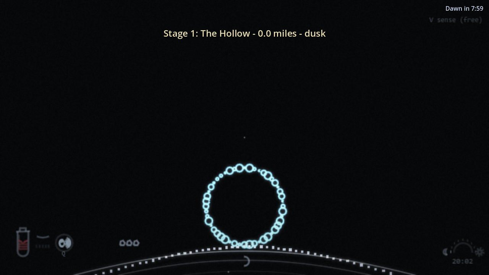
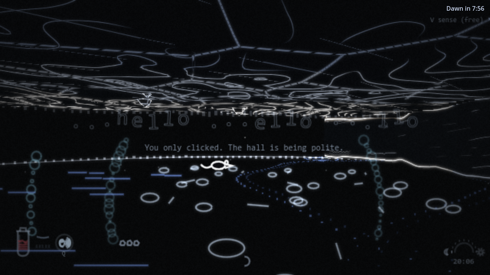

# Vampires Can't See

You are a vampire, and you cannot see. You echolocate like a bat: every click sends a sonar pulse through a medieval village at night,
and the walls light up for a moment and fade. People are never drawn directly. A pulse that reaches someone leaves a fading echo of their
outline where they stood. Ping again to see where they went.

**The Long Night (new in the Godot version).** The game is now a roguelike run. You wake in a coffin in a cave, go out into the dark and see how far you can get:
a sparse cave (the Hollow), Bramble Wood, Gallows Moor, the Old Road and the Crossroads Inn, with more stages planned (hamlet, village, town, city, keep).
Distance reached ("Miles from the Coffin") is your score. Every stage starts at dusk; dawn kills you outdoors, any roof keeps the sun off, and you can sleep at a
rest spot or wait out the day indoors (but people still go about their day). When you die you are Laid to Rest and keep **Grave Soil**, which buys upgrades in the Coffin shop.
The original five-night village run is still in the code (`--classic`) but hidden for now.




**This repository is now the Godot version (alpha).** The original browser game lives in [`html-version/`](html-version/) and is kept as the
reference the port is checked against (do not edit it from port work).

> **Version 0.22.0** (the JS game is 0.20.1). Latest: the Hollow cave got three polish passes (calmer first-night tutorial, a free first-night revive, shorter and more varied
> repeat-run caves, solid stalactites and quieter rock visuals), see [docs/CAVE_ITERATIONS.md](docs/CAVE_ITERATIONS.md). Full suite: 406 tests, about 1.26 million checks, 0 failures.
> Later stages are on hold until the first five have been playtested.

## Play

1. Install nothing: the Godot 4.4.1 binary is expected at the repo root as `Godot_v4.4.1-stable_win64.exe` (not committed: `*.exe` is git-ignored, download it from godotengine.org).
2. Double-click `play.bat` (or run `Godot_v4.4.1-stable_win64.exe --path project`). The first launch imports the audio, which takes a minute or two.

Headphones are strongly recommended: sound comes from where it happens, and it is half the game.

| Input | Action |
|---|---|
| Left-click / Space | Sonar pulse (works while you hold someone) |
| W A S D / arrows | Move and turn (the mouse turns too) |
| Hold right-click / R | Grab and drink from someone in front of you |
| Hold E while drinking | Restrain your victim (muffled, but half drink speed) |
| E | Open or close a door; sleep at your crypt or a safe spot |
| Hold E at a lit window | Listen to the people inside |
| G | Throw a rock (3 per run) |
| Q / Shift or C / F | Shriek / Mist / Still (unlock on nights 1, 2, 3) |
| V | Sense (Long Night): free in the cave, costs blood after it; shows the way and what is near |
| Tab | Skip the guided first night (first run only; it can be turned back on in the menu) |
| Esc | Pause |
| F3 | Debug text: fps, view, governor lines (debug builds also: M top-down map, F9 developer panel) |

Menus: New Long Night / Continue, The Coffin (Grave Soil shop), Stats, How to play, Export / Import save, Character creator, Settings (including the tutorial toggle).
Saves, settings and logs live in `%APPDATA%\Godot\app_userdata\Vampires Cant See\` (`vcs_run.json`, `vcs_meta.json`, `vcs_rogue.json`, `vcs_trek.json`, `settings.json`, `flags.json`, `creator.json`, `seen.json`, `vcs-log.txt`).
Full rules and numbers: [html-version/docs/MANUAL.md](html-version/docs/MANUAL.md) (the rules are identical).

## What changed from the browser version

A full GDScript port for Godot 4.4.1 (Compatibility renderer) plus the roguelike mode. The JS game is the single source of truth for the classic rules: it is untouched, and the port is checked against it
with Node-generated golden fixtures (about 1.1 million checks, including exact draw-call hashes for every figure, sprite, floor effect, HUD element
and the vessel overlay). The Long Night adds its own tests on top (406 tests in all).

- **Roguelike mode (Godot only):** seeded, generated stages (cave, wilderness, road, inn), Miles from the Coffin, Grave Soil and 21 unlocks, checkpoint saves at stage entry and sleep,
  heat (waiting out or sleeping through days draws hunters), wait-out-the-day with villagers who can find you, critters to feed on, a first-night tutorial with wayfinding (draft sound, glow-worm
  breadcrumbs, the V Sense), a shorter and more varied cave on repeat runs. Design: [docs/ROGUELIKE.md](docs/ROGUELIKE.md).
- **New ink look for the Long Night stages:** smooth contour walls, rock-vault cave ceilings with stalactites, strata, cracks and drip beads, in the same sonar-lit style as the original ([docs/STYLE.md](docs/STYLE.md)). Classic output is unchanged.
- **New sounds:** baked `rg_*` sounds for caves, wind, critters and the coffin shop (`tools/bake-rogue-audio.mjs`).
- **Same game:** sonar view with GPU wall, floor and ceiling shaders; echo people on a canvas layer; Forge and Schedule villagers with routines, conversations, barks and voices;
  listening at windows; feeding with struggle and restraint; powers, fear, blood gifts, the Essence shop, boons; 5-night runs; JS-compatible saves with export and import.
- **Look:** line and volumetric villagers (outfits, faces, hats, role items, rim light), the whole-body vessel pulse, hand-drawn HUD and icons, post effects (bloom,
  dusk/dawn grade, vignette, grain), the crypt title screen, warm-sense halos, head bob.
- **Audio:** the original synth voices re-baked to WAV (`tools/bake-audio.mjs`), ambience beds, heartbeats, breath, live villager speech.
- **Tools:** character creator, F9 developer panel with flags and tunables, M top-down map, log buffer and error screen, boot checks.
- **Differences:** fixed 640x360 internal frame scaled to the window; no browser tab lock; system file dialogs for save export and import;
  the adaptive quality governor is ported (no `renderScale`); no Windows export yet. The full list of what is not included is in [AI_HANDOFF.md](AI_HANDOFF.md).

## Repository layout

```
project/            the Godot project (project.godot): core/ game/ render/ ui/ audio/ data/ tests/
tools/              Node tools: golden fixture generators (tools/golden), audio baker, data exporter, JS reference-shot server
docs/               PORT.md (JS -> GDScript map), PARITY.md (fixtures), ROGUELIKE.md (The Long Night design), STYLE.md (ink look), CAVE_ITERATIONS.md (Hollow polish log)
PLAN.md             the original porting plan and phase list
AI_HANDOFF.md       start here if you are an AI or a new developer: rules, commands, architecture, NOT included, TODO
HOWTO-CLI-ANYTHING-GODOT.md, godot/, skills/, CLI-ANYTHING-HOWTO.md    the command-line harness used to drive Godot
html-version/       the original browser game (index.html, js/, css/, tests/, docs/, tools/, dist/): reference, do not edit
play.bat            launches the game
```

## Develop and test

```
Godot_v4.4.1-stable_win64.exe --headless --path project -s res://tests/run_tests.gd                      # everything (about 15 minutes)
Godot_v4.4.1-stable_win64.exe --headless --path project -s res://tests/run_tests.gd -- --filter=vessels  # one file
node tools/golden/<name>.mjs                                                                              # regenerate a fixture from html-version/js
```

Windowed scenarios (screenshots): `Godot_v4.4.1-stable_win64.exe --path project --rendering-driver opengl3 --write-movie <absolute dir>\f.png --fixed-fps 60 --quit-after 120 -- --scenario=<name>`
(scripts in `project/tests/scenarios/`). Parity details: [docs/PARITY.md](docs/PARITY.md). Module map: [docs/PORT.md](docs/PORT.md).

## Not yet judged by a person

Audio (new cave, wind and critter sounds included), the new ink look, the Sense and wayfinding feel, the tutorial pacing, and performance on other machines. Rules and rendering of the classic game are covered by the parity tests; the Long Night is covered by its own tests but has had little human play.
